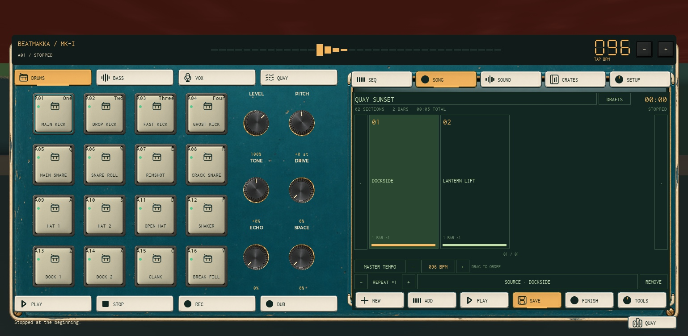

# Groovebox v4 — local Studio verification

**PASS: 41 Studio probe checks, zero failures.** Actual player/button checks also confirm all 64 pads, song finishing, private pause/resume and public playback. The delivered place matches all **223** Studio script fingerprints. The final console is empty.

Build: `NeedleQuay-Groovebox-v4.rbxlx`  
SHA-256: `b69f516b156155b371c8b02effd8379fc26dddfff9016a17fe7097a3a13d4db3`

The final Studio session is left at the groovebox with **DOCKSIDE**, **LANTERN LIFT**, and the saved **QUAY SUNSET** example. This example has two parts, two sections and 32 scheduled notes. Session data is not an embedded cloud save. A fresh Play session starts a fresh editable profile; `tools/qa/device_v4_demo_song.luau` reproduces the example through normal commands on an empty local profile.

## What changed

- Fixed looping snapshots after clear/delete, buffered recording deltas that could restore erased hits, held-pad/repeat cancellation, and stale paused resume snapshots.
- Fixed pause/resume replaying two pre-pause notes: explicit cursor floors survive the future start lead, and consumption never moves backward.
- Enabled all 64 local sources throughout audition, recording, Finish, listening, stage, concert and local musical progression. Pending approval metadata does not block local functions.
- Replaced rebuilt scrolling instrument pages with fixed pads/knobs/transport and Sequence, Song, Sounds, Crates and Setup LCDs. Listening, stage, jam and concert panels also use fixed/paged controls. The instrument contains **zero ScrollingFrames**.
- Added three generated, text-free local artworks: display bezel, silicone soft key and sleeve. All seven current UI artwork sets report loaded. Native labels and controls remain separate.
- Preload the full kit, avoid dry-hit DSP creation, retain stable widgets, and use exact onset derivatives for 13 padded sources. Originals remain preserved.
- PUBLIC now takes the selected saved song to the board, preserves that selection, and returns the player to the Roamer on Leave.

## Studio checks

| Probe | Passed | Scope |
|---|---:|---|
| Sequence transport server | 9 | Isolated production command/profile fixtures; live edits, clear/delete, recording, undo/redo, pinned songs |
| Sequence transport client | 4 | Consumer decisions with disposable audio recorder; cancellation, live FX, clear/delete, future resume/seek lead |
| Local finish/performance | 9 | Real services and session save with isolated profiles; failed-save rejection, dedupe, immutable snapshots, progression, stage and concert lifecycles |
| Local audio preview client | 4 | Actual loaded Sound voices, all 64 private sources, public sources, mute/stop and retained selection |
| Fixed public panels client | 15 | Crafted UI states in disposable hosts; desktop/627×252/portrait bounds, 44px footer targets, readable INFO pages, zero update-created widgets |

## Actual player and graphics checks

| Workflow | Result |
|---|---|
| Four banks through the real instrument keyboard | **64 distinct sounds / 64 starts / 64 accepted submissions** |
| Clear while playing with a pad physically held | Held true → false; flash false; zero remaining notes; zero later starts |
| Delete an active unreferenced sequence | Transport invalidated; zero later starts |
| Delete a draft-dependent section | Stops playback immediately; preserves required section with a clear dependency notice |
| Finished song through real Finish/Crates buttons | Saved named immutable revision selected and playable |
| Full song private playback with pause/resume | **32 expected / 32 actual starts**; paused cursor frozen; no new starts during pause; natural finite end |
| PUBLIC → Prepare → Start → natural end → Leave | **32 expected / 32 actual starts** in CourtyardListening; zero unavailable sources; finite end; returns and re-enters with saved song retained |
| Song cards and repeats | Drag reordered stable section IDs; Repeat changed 1→2; Undo restored both |
| Knob, trim and envelope pointer gestures | Gain 1→0, trim 0→0.98, attack 0→2; acknowledged values and released drag; restored afterward |
| Master mute | Zero starts while muted; visible SOUND OFF; restored |
| Note Repeat hold/release | Seven starts while held; zero after release; held false |
| Phone portrait | 401×720 instrument, 49px pads, transport visible, fixed Song screen |
| Phone landscape | 750×323 instrument, 47px pads, transport visible; FX recipes remain 74×26; Setup targets 47px tall and bounded |
| UI artwork | Faceplate, pad, knob, bezel-v4, softkey-v4, sleeve-v4, journal all loaded |

The pad performance run used 16 real key presses while the Sounds editor was active: **16 starts, zero GUI objects added/removed**, 226 measured frames, frame p50 **16.55 ms**, p95 **21.51 ms**, maximum **34.83 ms**. Input-handler-to-Sound:Play submission p95 was **0.282 ms**. This measures script submission, not physical speaker latency. The earlier eight-key baseline churned 5,648 UI objects.

[Portrait](groovebox-portrait.jpg) · [Landscape sound screen](groovebox-landscape-fx.jpg) · [Public performance](public-performance.jpg)

## Receipts and boundaries

`results.json` keeps raw probe/workflow results. `source-parity.json` records the 223-script build/Studio comparison. `local-package.json` records final ZIP hashes and CRC checks; `cleanup.json` records archives. The local companion payload contains **830** checksum-verified files. Source/package audio guards pass **12/12**. Scoped StyLua/Selene pass with zero errors or warnings.

No computer use, Roblox uploads, publication, Tripo spending, Git commit or push occurred. Studio saves are session-only. Independent two-client acceptance, physical input-to-speaker latency and human listening/art approval were not claimed. Those boundaries do not disable the working local Finished Song/public routes.
