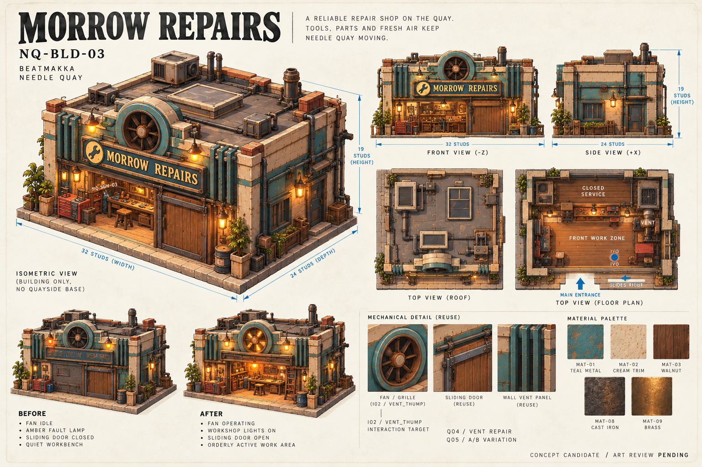
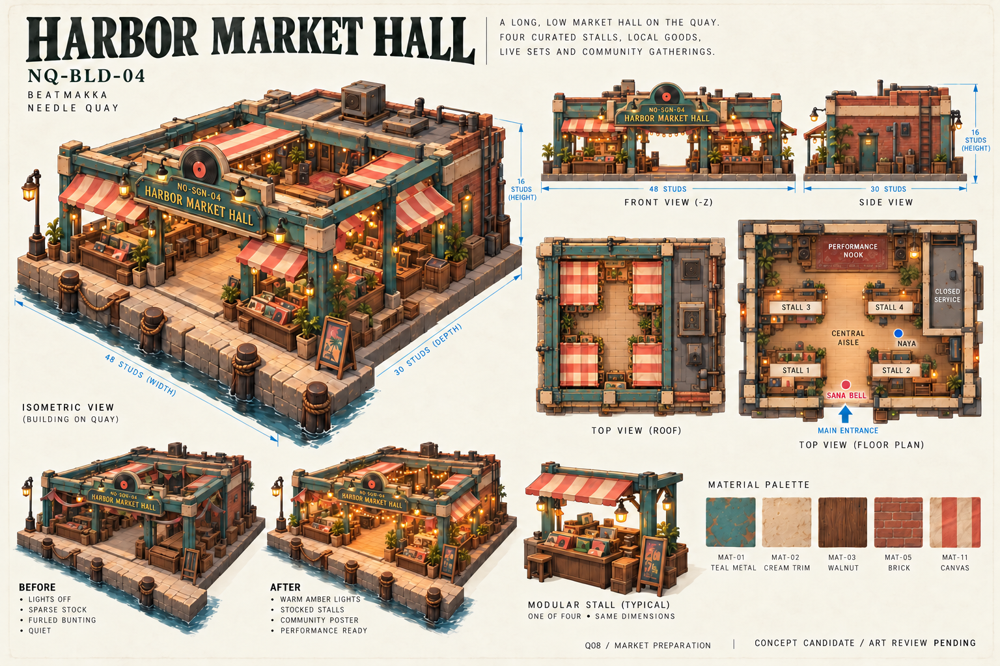
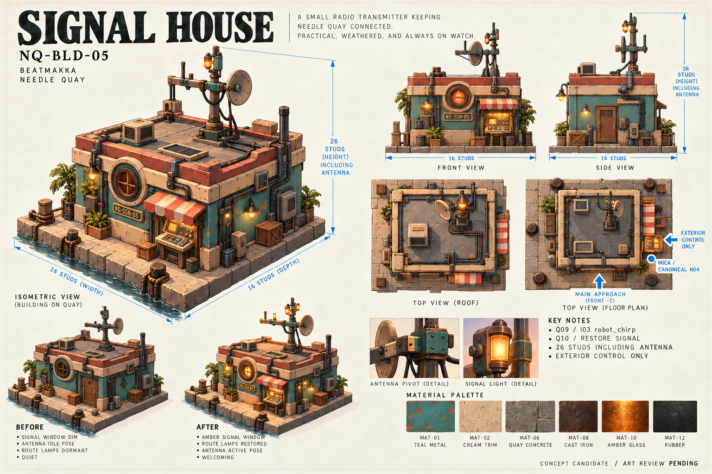

# Hero sheets 03–05 — Morrow Repairs, Harbor Market Hall, Signal House

25 октября 2026. Продолжение первых двух листов, с той же утверждённой board, палитрой, типографикой и структурой подачи. **Концепты одобрены пользователем** — [receipt](ART_APPROVAL_2026-10-25.json). Исторические PNG footers сохраняют состояние на момент генерации. Это не точные строительные чертежи или готовые игровые модели. Видовые картинки и стрелки размеров иллюстративны; контракты и authored blockout остаются источником точной геометрии.

## NQ-BLD-03 — Morrow Repairs

- Габарит: **32 × 24 × 19 studs**, Ш × Г × В; front -Z, layout pivot по центру пола. Крыша, вентиляция и трубы должны укладываться в общую высоту при точном моделировании.
- Фасад: сдвижная дверь с отдельным rail/leaf, крупные вентиляционные рёбра, передний рабочий участок, инструментальная стойка и верстак. Задние помещения декоративные и закрыты для прохода.
- Reuse: M01/M02 стеновые панели, M03 стойки, M04 дверной проём, M07 пол, M08 кровля, M10 вывеска; ритм фасада строится повторением broad vent ribs. Это направления сборки, не разрешение масштабировать закреплённые модули. Точный rail и ход двери проектируются отдельно.
- Ivo отмечен точкой у передней рабочей зоны. Q04 восстанавливает вентиляцию и открывает `I02 vent_thump`; Q05 связан с вариациями A/B. I02 сохраняет каноническую привязку к P16: показанный фасадный вентилятор — предложение для visual/mechanism wrapper, **не новый canonical I02 mesh и не автоматическая замена P16**.
- MAT-01 teal metal, MAT-02 cream trim, MAT-03 walnut, MAT-08 cast iron, MAT-09 brass. NQ-SGN-03; POST-03 Repair Day и пакет NQ-WORKSHOP размещаются отдельной графикой на стадии production.
- Before/After: та же оболочка и тот же механизм; idle/fault → рабочие лампы и работа вентиляции. Fan/grille, sliding leaf, fault lamp — отдельные targets. Не считать нарисованные лопасти или открытый вход доказательством rig/collision acceptance.
- Коллизии: простые стеновые proxies, свободная зона входа и рабочий маршрут; без collision на мелком инструменте, рёбрах и трубах. LOD сначала убирает мелкую оснастку; новые triangle budgets не назначались.

## NQ-BLD-04 — Harbor Market Hall

- Габарит: **48 × 30 × 16 studs**, включая кровлю; front -Z. Низкий полуоткрытый павильон с металлическим каркасом, цветными навесами и деревянными прилавками.
- Ровно **четыре** базовых stall-модуля; центральный проход и маленькая performance nook — отдельные функции, а не пятый прилавок. Первый уровень проходимый; технический объём закрыт, полноценного второго этажа нет.
- Reuse: одинаковая конструкция четырёх прилавков с вариативным товарным dressing; общие стойки, awnings, рамы, пол и кровля. Точки соединений, натяжение навеса и collision-прокси уточняются детерминированно при моделировании.
- Основная точка Sana Bell у входа/центрального прохода; Naya посещает vinyl stall по квесту. Q08 — подготовка рынка к музыкальному событию; соседние Q06/Q07 остаются связаны с Needle Records и Beat Shelf. Выступление не требует человеческой аудитории.
- MAT-01 teal metal, MAT-02 cream trim, MAT-03 walnut, MAT-05 brick, MAT-11 canvas. NQ-SGN-04, POST-02/POST-04/POST-07 и NQ-COMMUNITY — отдельные production-графические позиции, а не готовые экспорты из картинки.
- Before/After: неизменная планировка, четыре прилавка dim/sparse → stocked/lit и подготовленная маленькая сцена. Освещение и локальные NPC presentation states остаются персональными при будущей runtime-интеграции.
- Коллизии на опорах/прилавках простые, декоративные навесы и подвесная графика не мешают камере. Цель непрерывного свободного маршрута минимум 6 studs требует avatar review; изображение не является измерением clearance.

## NQ-BLD-05 — Signal House

- Габарит: **16 × 16 × 26 studs**; **26 — общая высота до вершины антенны**, не высота домика. Платформа волнореза — отдельное окружение, её размеры не входят в габарит здания.
- Приземистый радиодом, высокая тонкая антенна, круглое сигнальное окно, интегрированные кабельные трассы; внешний доступ к одному пульту. Полноценный доступный интерьер не нужен.
- Reuse: малые стеновые/угловые детали общего kit vocabulary, shared cream trim, графитовые опоры/кабели; основание волнореза MAT-06. Антенна, её pivot, сигнальный insert и внешний control desk — именованные отдельные цели для последующего authored assembly.
- Mica — только подписанная точка размещения **канонического H04**, без нового дизайна робота. Q09 использует `I03 robot_chirp`, Q10 восстанавливает сигнал и связь с The Lantern Room; I03 не переименовывается и не создаётся заново.
- MAT-01 teal metal, MAT-02 cream trim, MAT-06 quay concrete, MAT-08 cast iron, MAT-10 amber glass, MAT-12 rubber. NQ-SGN-05, POST-05/POST-08, GRA-05/06/08 и NQ-SIGNAL оформляются отдельно.
- Before/After: одна и та же геометрия; тусклое окно/idle antenna/dormant route lights → amber signal и восстановленные огни маршрута. Рисунок антенны не является готовой анимацией или инженерным узлом.
- Collision на простом домике/основании; без decorative cable collisions. Внешний путь к пульту и обход домика сохраняются; окончательная проверка камеры и аватара впереди. Удалённый LOD сохраняет читаемые силуэты домика и антенны.

## Источники и границы batch

Габариты, IDs, NPC и квестовые связи сверены с исходным пользовательским register и `data/needle-quay-environment.v1.json`. Для визуального единства использованы уже vendored approved board и NQ-BLD-01; внешние материалы и модели не добавлялись. Инвентарь `C:/Users/slavd/OneDrive/Pictures/Assets` обновлён на 25 октября: 6 343 файла.

Точные prompts сохранены в `assets/concepts/needle-quay/prompts-03-05.json`; output hashes и provenance — в соседнем `provenance-03-05.json`. Инструмент: встроенный `image_gen`. Tripo calls/spend — 0. Геометрия blockout, gameplay, профили, audio IDs и production asset contracts в этом batch не менялись. Тесты, uploads, publishing, commits и push не выполнялись.

Все пять hero concepts теперь представлены листами. Art approval, точные ортографические чертежи, DCC-clean, native production mesh import и runtime acceptance остаются отдельными открытыми стадиями.
