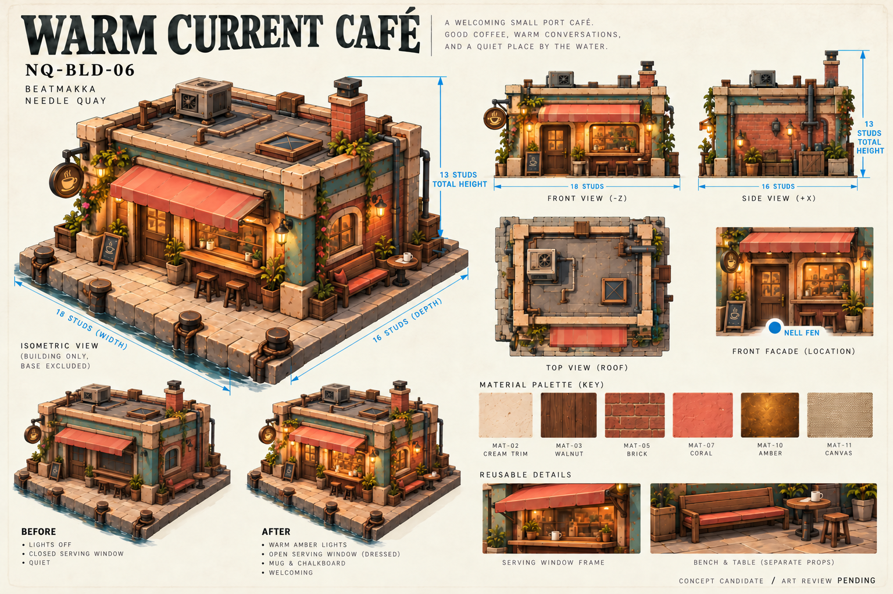
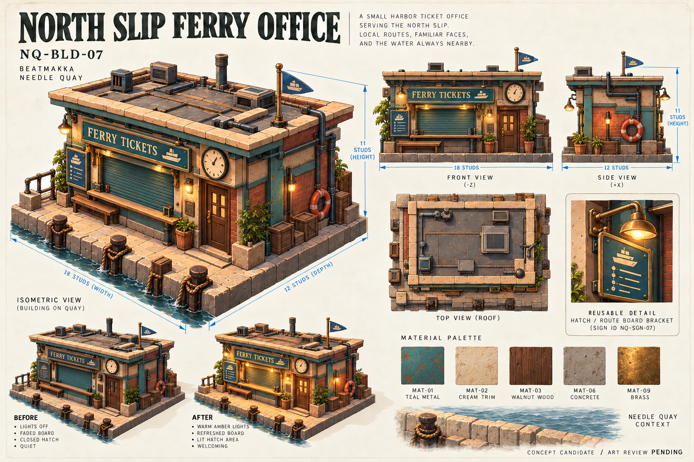
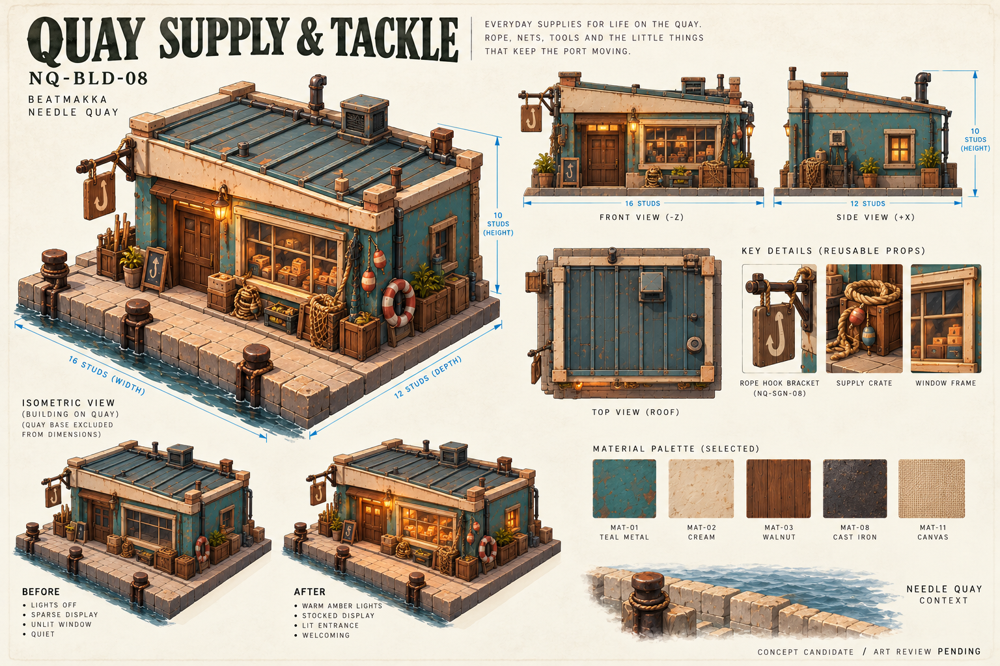
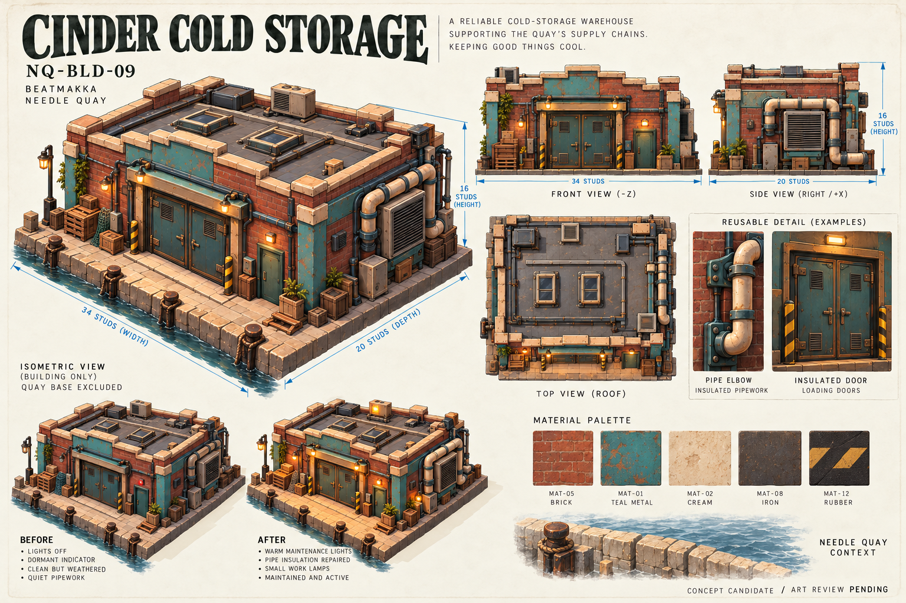
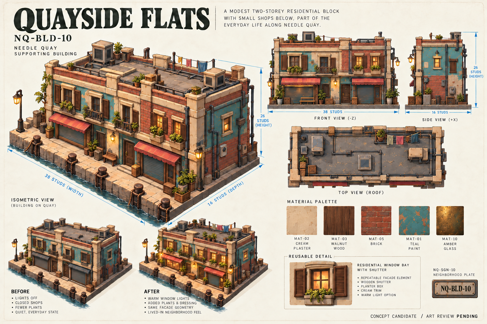
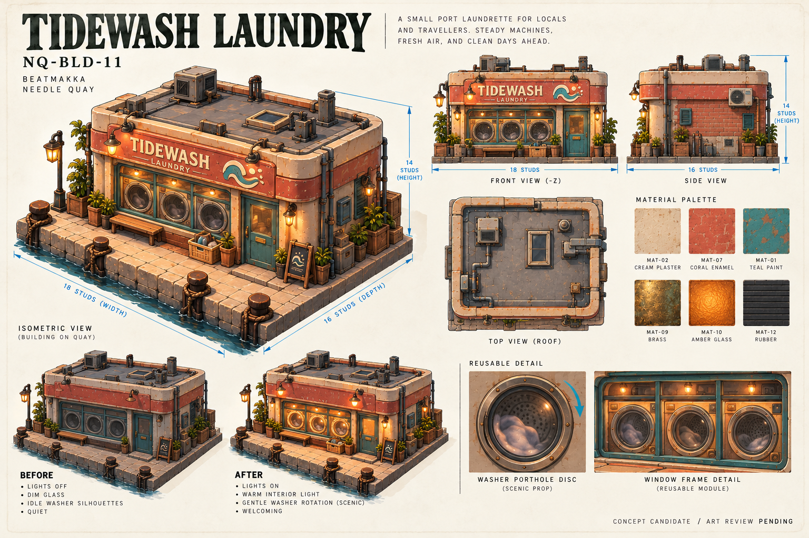
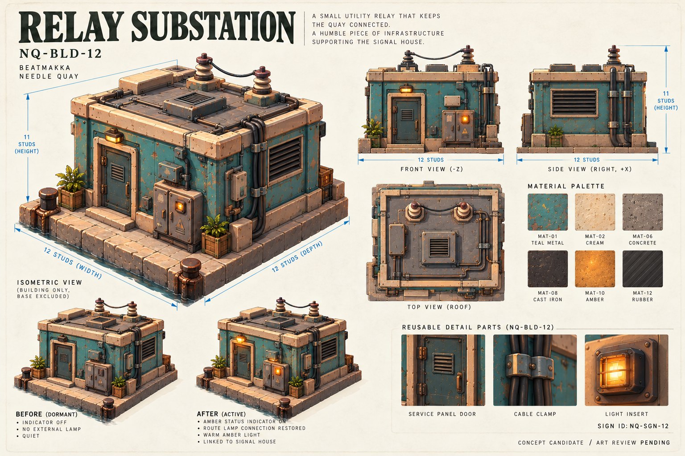
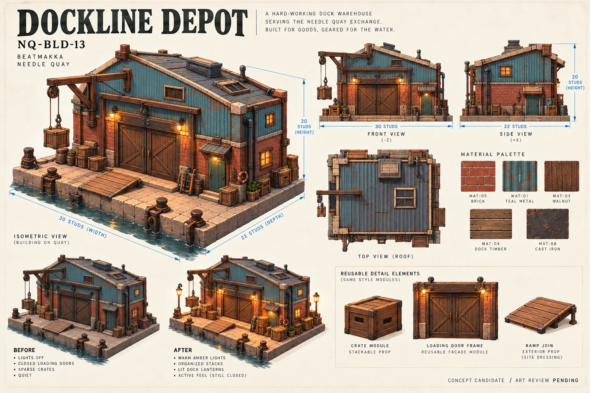

# Needle Quay — supporting building sheets 06–13

25 октября 2026. Восемь отдельных concept sheets по пользовательскому register, в той же визуальной системе, что и hero-пятёрка. **Все концепты одобрены пользователем** — [receipt](ART_APPROVAL_2026-10-25.json). Подписи ART REVIEW PENDING в исходных PNG — историческое состояние при генерации. Dimensions и строительные ограничения заданы реестром; рисованные виды не заменяют точные чертежи, коллизии или DCC-модели.

Общий формат: цветная изометрия, front/side/top roof views, Before/After, material-family swatches и reusable-detail inset. Полноценные доступные интерьеры supporting buildings не создаются. Освещение за окнами, scenic props и тёмные подложки витрин не означают playable комнаты.

## NQ-BLD-06 — Warm Current Café

**18 × 16 × 13 studs**, Ш × Г × полная В. Небольшое кафе с тёплой витриной, walnut-дверью, коралловым навесом, внешней serving ledge, скамьёй и столиком. Nell Fen — только точка расположения возле фасада. Короткие разговоры и слухи, без нового квестового gate. Before/After меняет свет и dressing, а не оболочку. Небольшой cup symbol отличает кафе от record shop.

Материалы: MAT-02/03/05/07/10/11. Вывеска NQ-SGN-06; community board отдельным графическим элементом. Reuse: рама serving window, корпус навеса, наружная скамья. Дымоход и оборудование кровли должны укладываться в общую высоту 13 при точном моделировании; site base не входит в габарит здания.

## NQ-BLD-07 — North Slip Ferry Office

**18 × 12 × 11 studs**. Низкая билетная касса: ticket hatch, отдельная дверь, небольшой overhang, часы и внешняя route board. Функция — портовая навигация и атмосфера; лист не реализует ferry travel. Все проёмы фасадные, интерьер не открыт.

MAT-01/02/03/06/09. NQ-SGN-07, NQ-DOCK и wayfinding как отдельная production-графика. Reuse: hatch/shutter и bracket табло. Before/After — свет ticket window и обновлённая route board; схемы маршрутов на изображении иллюстративны, игровая информация должна быть отдельной локализуемой графикой/UI.

## NQ-BLD-08 — Quay Supply & Tackle

**16 × 12 × 10 studs**. Низкий магазин снастей и докового инвентаря: простая крыша, центральная дверь, витрина, канаты, сети и внешний tool/tackle rack. Поддерживает Dockside Exchange и существующую роль Tori; не создаёт нового персонажа или квеста.

MAT-01/02/03/08/11. NQ-SGN-08 и NQ-DOCK labels. Reuse: ящик, rope-hook bracket, окно. Before/After — stocked display и входная лампа. Реквизит не перекрывает внешний маршрут; декоративные сети и канаты без мелкой collision-геометрии.

## NQ-BLD-09 — Cinder Cold Storage

**34 × 20 × 16 studs**. Широкий холодильный склад с утеплёнными loading doors, служебной дверью, refrigeration grille и наружными трубами. Закрытая supporting оболочка, без полного интерьера. Ambient industrial sound — функция окружения, не автоматически новый назначаемый sample или замена I02.

MAT-01/02/05/08/12. NQ-SGN-09; NQ-WORKSHOP маркировка. Reuse: утеплённая дверь, elbow/pipe clamps, вентиляционная решётка. Before/After — небольшие service lights и аккуратные maintenance details. Пайпы, фасад и верх кровли должны помещаться в габарит; фактические UV, трубоузлы и collision proxies авторятся позже.

## NQ-BLD-10 — Quayside Flats

**38 × 16 × 26 studs**. Длинный неглубокий жилой фасад, два уровня: нижние магазины и верхние residential windows. Несколько shop/entry doors, разный ритм окон, shutters, сдержанные window boxes и rail details. Верхний силуэт формирует квартал; ни квартиры, ни нижние магазины не получают полноценных интерьеров.

MAT-01/02/03/05/10. NQ-SGN-10 — небольшая neighborhood plate. Reuse: window bay, shutter, ground-floor frame. Before/After — выборочные тёплые окна и локальное dressing. Новые магазины внутри фасада не считаются дополнительными зданиями или canonical asset IDs.

## NQ-BLD-11 — Tidewash Laundry

**18 × 16 × 14 studs**. Маленькая прачечная, cream/coral фасад, отдельная дверь, крупные круглые washer portholes за закрытой витриной. Это scenic window backing, а не новый playable интерьер. Wave/suds symbol помогает отличить стиральные диски от винилового знака Needle Records.

MAT-01/02/07/09/10/12. NQ-SGN-11. Reuse: окно и отдельный диск/рамка washer porthole. Before/After — свет и состояние scenic washers. Предложенные вращение и ритмический фон не считаются изготовленной анимацией или аудио; декоративные диски без physics/collision.

## NQ-BLD-12 — Relay Substation

**12 × 12 × 11 studs**. Маленькая закрытая подстанция, наружный шкаф, service door, вентиляционные прорези, cable conduits и отдельный amber status insert. Визуально связана с Signal House, но не становится второй радиобашней; высокой антенны и полноценного интерьера нет.

MAT-01/02/06/08/10/12. NQ-SGN-12 и NQ-SIGNAL markings. Reuse: cabinet/door, cable clamp, light insert. Before/After — dormant/active indicator и маршрутные огни. Q10 связь остаётся спецификацией существующей главы, без новой runtime-логики или sample ID.

## NQ-BLD-13 — Dockline Depot

**30 × 22 × 20 studs**. Портовый склад с невысокой асимметричной скатной крышей, loading doors, служебной дверью, отдельной короткой рампой и повторяемыми ящиками/рамами. Закрытый единый складской объём, без полного интерьера. Site ramp и staging crates — отдельное окружение; не скрытая прибавка к заданному габариту оболочки.

MAT-01/03/04/05/08. NQ-SGN-13, NQ-DOCK labels. Reuse: crate/frame/ramp join, short pulley bracket. Before/After — свет фонаря и упорядоченные crate stacks. Переход рампы и коллизии должны быть построены детерминированно; анимация разгрузки не создаётся этим листом.

## Production handoff

Каждый лист сохраняет связь с существующим `NQ-BLD-XX` и соответствующим `NQ-SGN-XX`, не добавляя новые canonical package IDs. Все габариты — authored project constraints, не лимиты Roblox. Сохранять существующие 4/8-stud module contracts; неподходящие пролёты закрывать заранее спроектированными infill, а не произвольным масштабированием канонических модулей.

Общие material families сопоставлены существующему atlas в register; swatches на картинках не являются готовыми PBR-наборами. Надписи, posters, decals и gameplay localization создаются отдельно. Новые exterior props на иллюстрациях — design proposals, не произведённые модели и не дополнительные принятые ассеты.

Точные prompts: `assets/concepts/needle-quay/prompts-06-13.json`. Output hashes, references, contract snapshots и замечания к видам: `assets/concepts/needle-quay/provenance-06-13.json`. Инструмент — встроенный `image_gen`, без Tripo, uploads, publishing, commits или push. Human art approval, DCC-clean, native Studio production import и runtime acceptance остаются открытыми. Текущая blockout-сцена и gameplay в этом batch не меняются.
